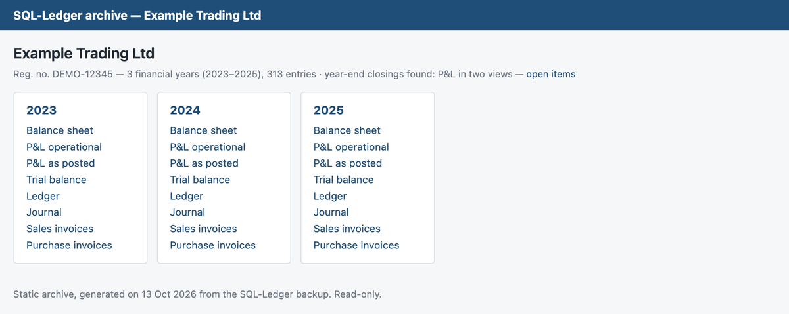
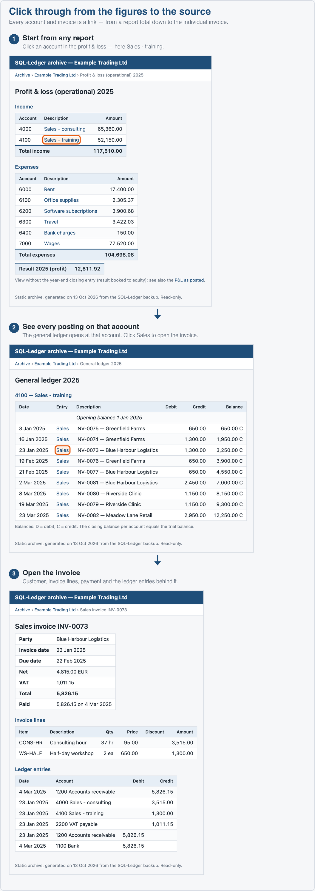
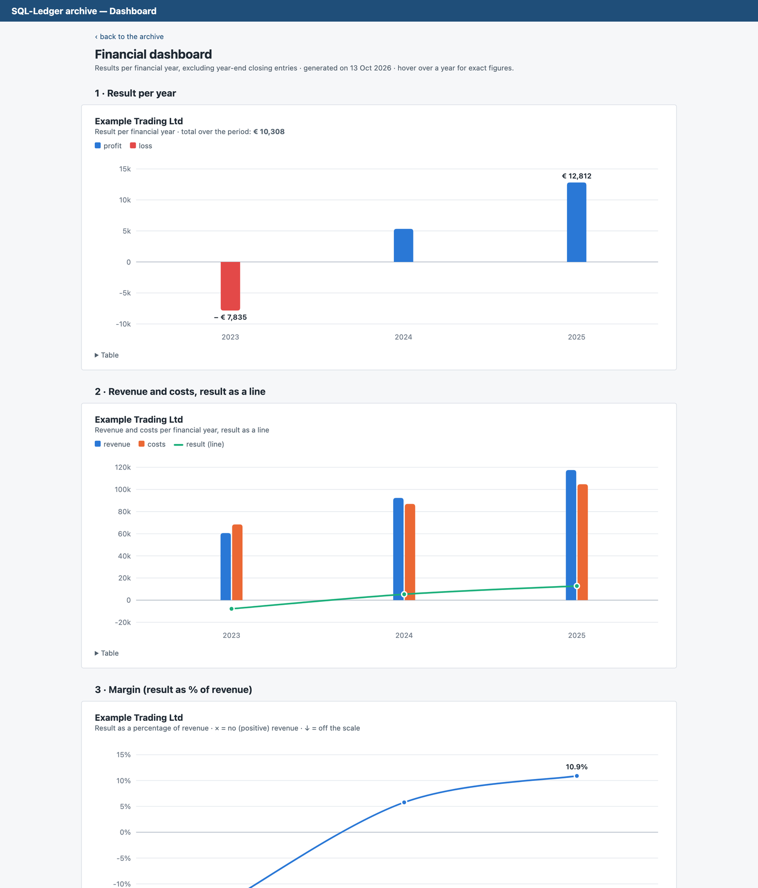
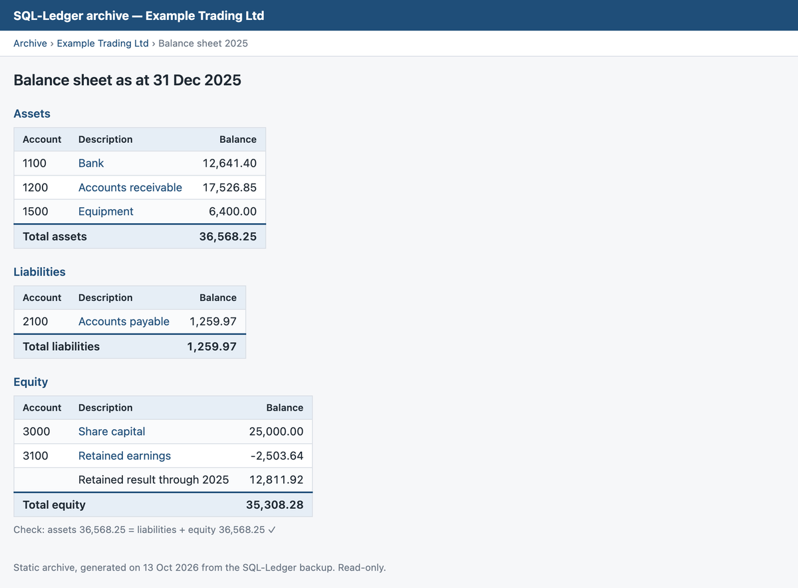
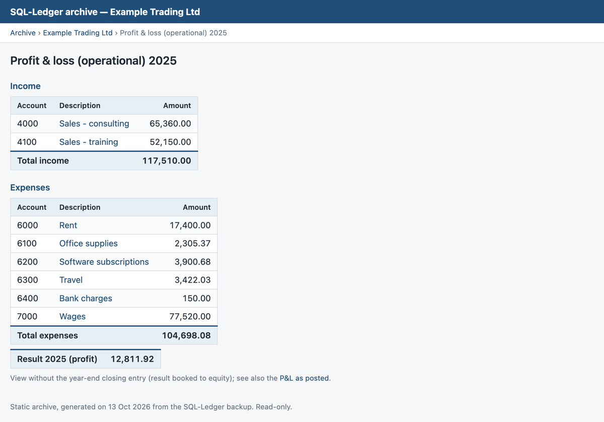
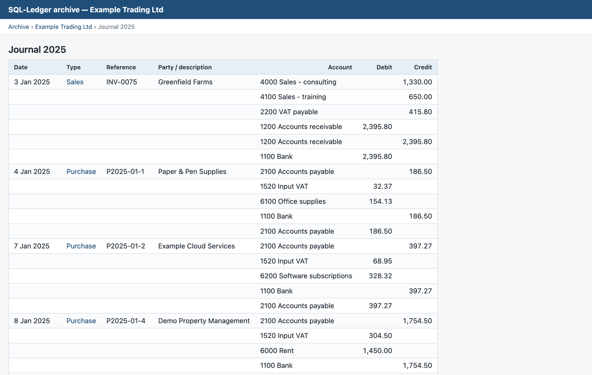
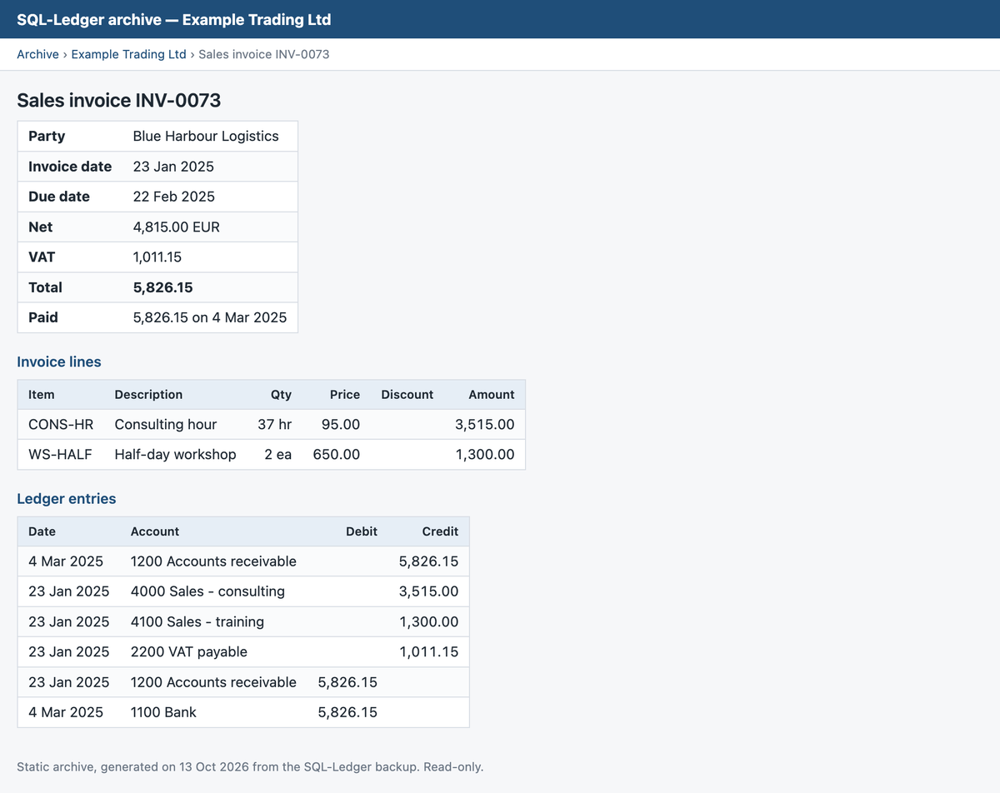
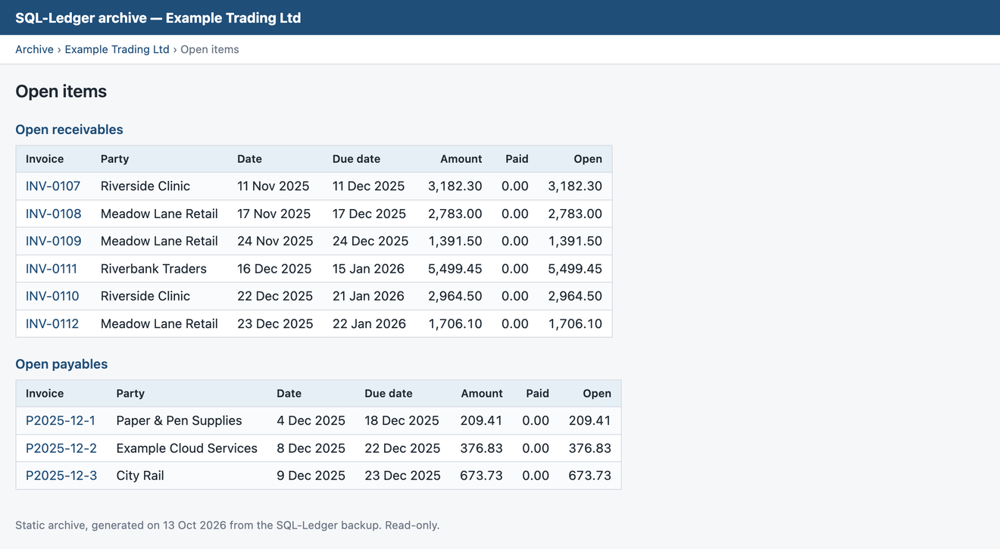
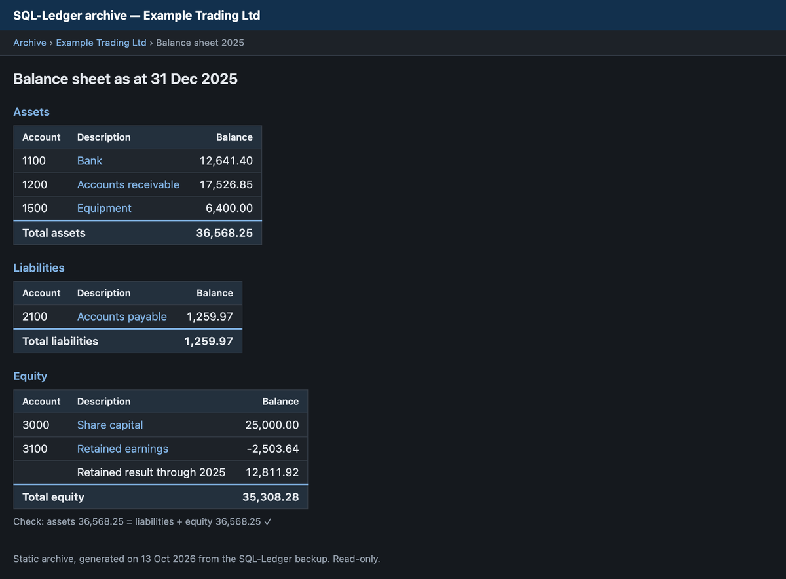

# SQL-Ledger Archive Maker

Turn your **SQL-Ledger** books into a browsable, read-only **website on your
own computer** — balance sheets, profit & loss, ledgers, journals, invoices and
a dashboard with yearly charts. No database, no server, no installation beyond
Python 3.

**Why you'd want this**

- 🗂️ **Keep your books readable for years** — after you stop using
  SQL-Ledger or move to other software, you still have to keep your records
  (for the tax office, an audit or yourself). The archive needs nothing but a
  web browser: no old SQL-Ledger installation to keep alive.
- 🤝 **Share your books with your accountant, auditor or business partner** —
  send them the archive folder and they can browse every report, ledger and
  invoice themselves, without an SQL-Ledger login, without installing
  anything, and without being able to change a thing.
- 🔎 **Click through from the figures to the source** — every account in a
  report links to its ledger, every posting to its invoice. Questions like
  *"what makes up this amount?"* answer themselves.
- ✅ **Built-in checks** — every balance sheet and trial balance shows whether
  it adds up.



## What you get

For every company (dataset) in your backups, and for every financial year:

| Report | What it shows |
|---|---|
| **Balance sheet** | Assets, liabilities and equity at year end, with an automatic check that both sides agree |
| **Profit & loss** | Two views when the company has year-end closings: *operational* (real figures, closing entry left out) and *as posted* |
| **Trial balance** | Opening balance, movements and closing balance per account, with a debit = credit check |
| **Ledger** | Every posting per account |
| **Journal** | Every transaction with all its lines |
| **Sales & purchase invoices** | Invoice lists per year, and a page per invoice with its lines and ledger entries |
| **Open items** | Receivables and payables that were still unpaid in the backup |
| **Dashboard** | Charts per year: result, revenue vs. costs, and margin |

## Click through from the figures to the source

Everything is linked. Start at any report total, click the account to see
every posting behind it, and click a posting to open the invoice — with its
lines, payment and ledger entries.



## Share it with your accountant

The archive is a folder of ordinary web pages, so sharing it is easy:

1. Zip the `archive` folder (right-click → *Compress* on Mac,
   *Send to → Compressed folder* on Windows).
2. Send the zip file through a secure channel you trust — for example your
   accountant's client portal or an encrypted file-sharing service.
3. They unzip it and double-click `index.html`. That's all: no login, no
   software, works offline, and nothing in it can be changed.

> [!CAUTION]
> The archive contains your complete financial records. Share it only with
> people who should see them, and never put it on a public website.

## More screenshots

The screenshots below come from the included demo company *Example Trading Ltd*
(fictitious data — see [Try it with demo data](#try-it-with-demo-data)).

**Dashboard** — results per financial year



**Balance sheet** — with the assets = liabilities + equity check



**Profit & loss (operational view)**



**Journal** — every transaction, linked to its invoice



**Invoice** — header, invoice lines and the ledger entries behind it



**Open items** — what was still to be received or paid



**Dark mode** — the archive follows your computer's light or dark setting



## Requirements

- **Python 3** (3.9 or newer). Nothing else: the script only uses Python's
  standard library.
  - **Mac:** usually already present. If not, macOS offers to install it the
    first time you run the script, or get it from
    [python.org](https://www.python.org/downloads/).
  - **Windows:** install from [python.org](https://www.python.org/downloads/)
    and tick **"Add python.exe to PATH"** during installation.
  - **Linux:** already installed on almost every distribution.
- One or more **SQL-Ledger backup files** (`.sql`). Backups from SQL-Ledger
  2.6 through 3.x are supported.

You do **not** need PostgreSQL, Docker, Perl, a web server or a working
SQL-Ledger installation.

## How to use it

> 📖 New to this? The **[step-by-step user guide](docs/USER_GUIDE.md)** explains
> everything with pictures, from installing Python to sharing the result.

### 1. Get the tool

Click **Code → Download ZIP** on this page and unzip it, or clone it:

```bash
git clone https://github.com/Mattsqlledger/sql-ledger-archive-maker.git
```

### 2. Make a backup in SQL-Ledger (if you don't have one yet)

In SQL-Ledger, log in to the company and choose **System → Backup → Save to
file**. You get a `.sql` file (sometimes gzipped: unzip a `.sql.gz` first).
Repeat this for every company you want to archive.

### 3. Put the backups in the `backup` folder

Copy your `.sql` files into the `backup` folder (or next to `make_archive.py`).
Several companies at once is fine — each one gets its own section in the archive.

### 4. Run it

- **Mac:** double-click `make-archive.command`
  (the first time, macOS may ask you to confirm: right-click → *Open*).
- **Windows:** double-click `make-archive.cmd`.
- **Any system, from a terminal:**

  ```bash
  python3 make_archive.py
  ```

The script prints which companies it found and how many years and entries
each has.

### 5. Open the archive

Open the new `archive` folder and double-click **`index.html`**. The archive is
a set of plain HTML files: it works offline in any browser, and you can copy
the whole `archive` folder to a USB stick, a NAS or cloud storage.

## Try it with demo data

Want to see what it does before using your own data? The `demo` folder
contains a fictitious company, *Example Trading Ltd*, with three years of
invoices, payments, VAT returns and year-end closings.

```bash
cp demo/demo-company.sql backup/
python3 make_archive.py
```

Then open `archive/index.html`. (`demo/make_demo_backup.py` regenerates the
demo file; you don't need it for normal use.)

## Good to know

- **Your data stays on your computer.** The script reads the backup file and
  writes HTML files. It sends nothing anywhere and needs no internet.
- **Read-only.** The archive is a snapshot; you cannot change bookings in it.
  Your original backup file is not modified.
- **Checks you can rely on.** Every balance sheet shows whether assets equal
  liabilities + equity, and every trial balance whether debits equal credits.
  If you see **DIFFERENCE**, investigate that year before relying on it.
- **Two P&L views.** If the company used SQL-Ledger's year-end closing, the
  *as posted* P&L of a closed year adds up to zero (the result was moved to
  equity). The *operational* view leaves the closing entry out, so you see the
  real result.
- **Date format is detected automatically** (dd-mm-yyyy or US mm/dd/yy). A
  warning appears only if the file is genuinely ambiguous — check the dates in
  the archive if you see it.
- **Large companies** (tens of thousands of invoices) can take a few minutes
  and produce many small files. That is normal.
- **Re-running** overwrites the files in the `archive` folder. Move or rename
  the folder first if you want to keep an earlier version.

## Troubleshooting

| Problem | Solution |
|---|---|
| `No .sql files found` | Put the backup files in the `backup` folder or next to `make_archive.py`. A `.sql.gz` file must be unzipped first. |
| `python3: command not found` / Python not installed | Install Python 3 (see [Requirements](#requirements)). On Windows, use `py make_archive.py`. |
| Mac says the `.command` file cannot be opened | Right-click it → *Open* → *Open*. Or run `python3 make_archive.py` in Terminal. |
| `no transactions found, skipped` | That backup contains no bookings (for example an empty test company). |
| Dates look wrong | The backup's date format was ambiguous; see the warning printed when you ran the script. |

## Privacy

- The script runs entirely on your own computer and sends nothing anywhere.
- Never commit your own backups or the generated archive to a public
  repository: they contain your full financial records. This repository's
  `.gitignore` already excludes `*.sql` files (except the demo) and the
  `archive` folder.
- All screenshots in this repository come from the fictitious demo company;
  they contain no real data.

## License

Copyright (C) 2026 Matthijs Havinga

This program is free software: you can redistribute it and/or modify it under
the terms of the **GNU General Public License, version 3 or (at your option)
any later version**. It is distributed in the hope that it will be useful, but
WITHOUT ANY WARRANTY. See [LICENSE](LICENSE) for the full text.

SQL-Ledger itself is a separate product by DWS Systems Inc. and is not part of
this repository.
