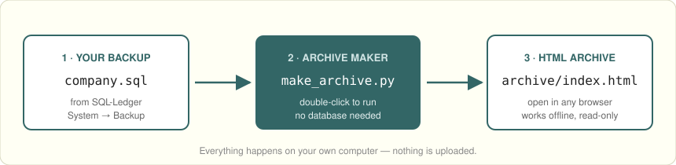
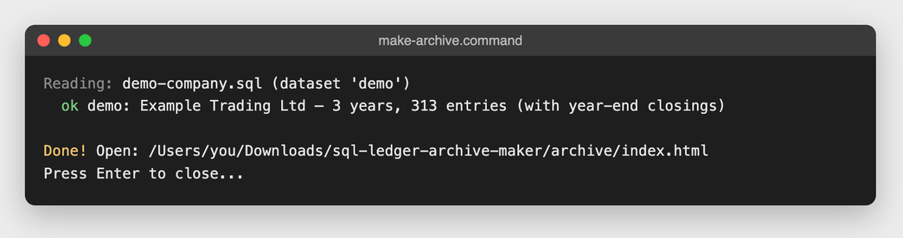
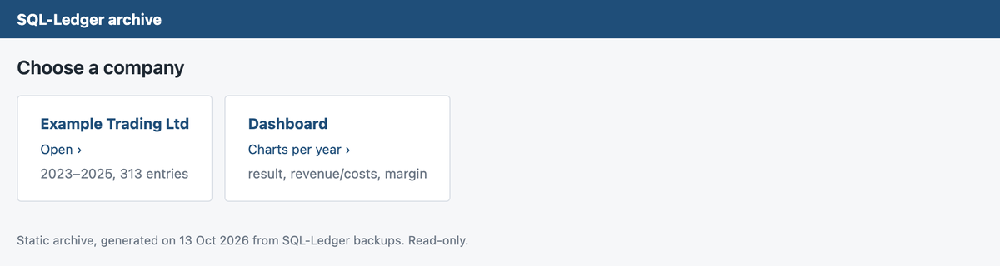
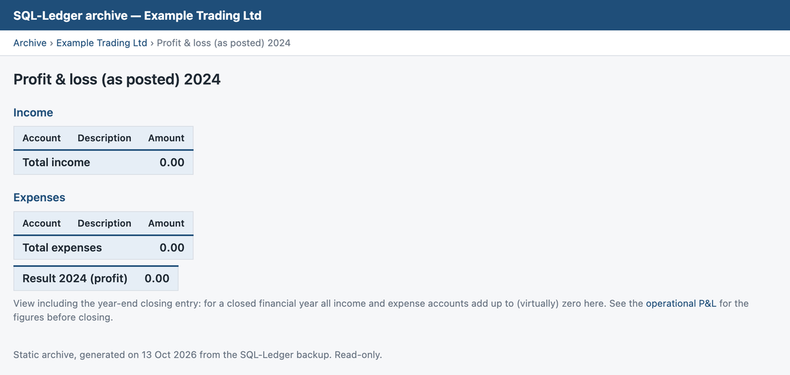
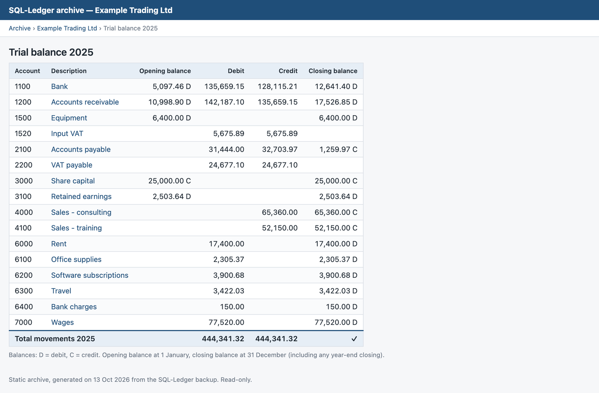
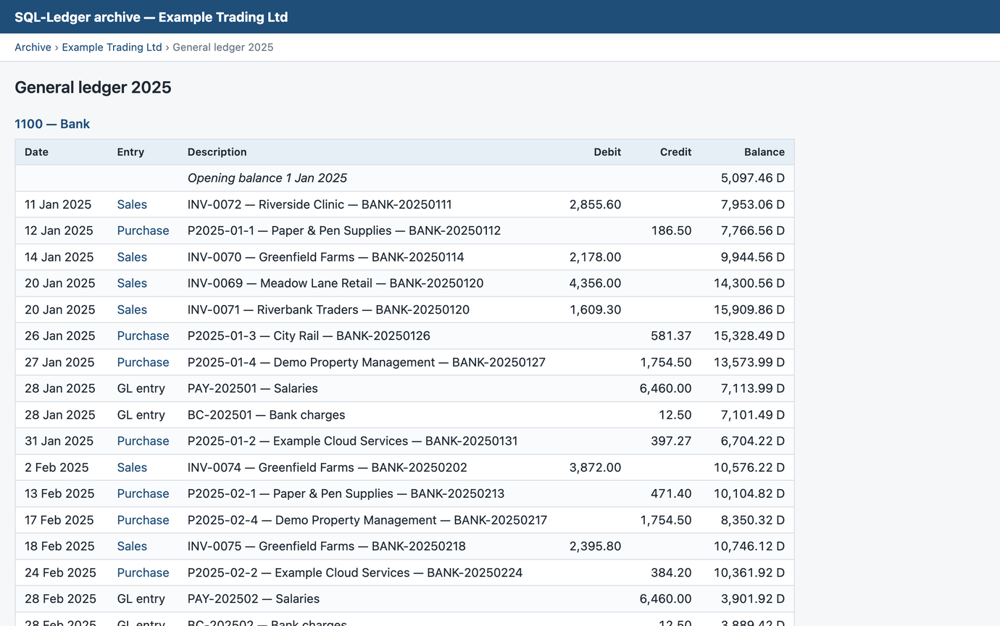
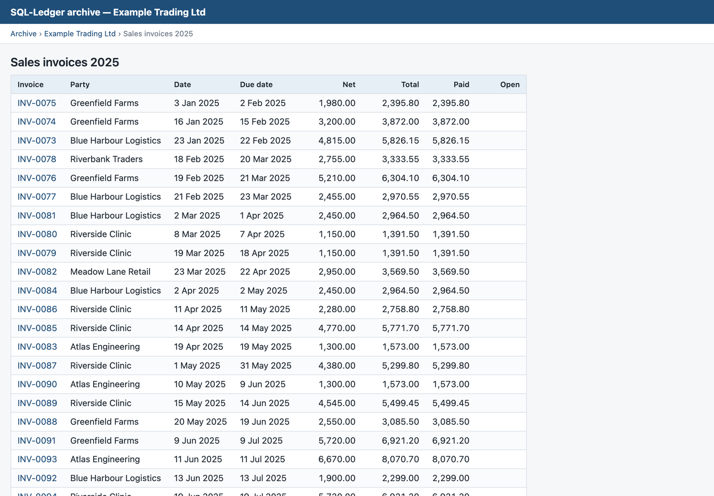

# User guide — SQL-Ledger Archive Maker

This guide walks you through turning your SQL-Ledger books into a browsable
archive, step by step — to keep them readable for years, and to share them
with your accountant, auditor or business partner. You don't need any
technical knowledge: if you can copy a file and double-click, you can do this.
Plan on about 15 minutes the first time.



**Contents**

1. [Before you start](#1-before-you-start)
2. [Install Python (one time only)](#2-install-python-one-time-only)
3. [Download the Archive Maker](#3-download-the-archive-maker)
4. [Make a backup in SQL-Ledger](#4-make-a-backup-in-sql-ledger)
5. [Put the backup in the right folder](#5-put-the-backup-in-the-right-folder)
6. [Run the Archive Maker](#6-run-the-archive-maker)
7. [Open and explore your archive](#7-open-and-explore-your-archive)
8. [Store and share the archive](#8-store-and-share-the-archive)
9. [Understanding the reports](#9-understanding-the-reports)
10. [Questions and problems](#10-questions-and-problems)

---

## 1. Before you start

Check that you have:

- [ ] A computer with **Windows**, **macOS** or **Linux**
- [ ] Your **SQL-Ledger backup file(s)** (`.sql`) — or access to SQL-Ledger to
      make one (see [step 4](#4-make-a-backup-in-sql-ledger))
- [ ] About **3× the size of your backup** in free disk space for the archive

> [!NOTE]
> The Archive Maker only **reads** your backup. It never changes it, never
> connects to the internet and never uploads anything.

## 2. Install Python (one time only)

The Archive Maker is a small Python program. Python is free and is already
present on most Macs and Linux computers.

<details>
<summary><b>Windows</b></summary>

1. Go to [python.org/downloads](https://www.python.org/downloads/) and click
   the big yellow **Download Python** button.
2. Open the downloaded file.
3. **Important:** on the first screen, tick **"Add python.exe to PATH"**,
   then click **Install Now**.
4. When it says *Setup was successful*, click **Close**.

</details>

<details>
<summary><b>Mac</b></summary>

Usually nothing to do. If Python is missing, macOS shows a window offering
to install the *command line developer tools* the first time you run the
Archive Maker — click **Install** and wait a few minutes. You can also
install Python from [python.org/downloads](https://www.python.org/downloads/).

</details>

<details>
<summary><b>Linux</b></summary>

Python 3 is already installed on practically every distribution. Check with
`python3 --version` in a terminal.

</details>

## 3. Download the Archive Maker

1. At the top of the [project page](../), click the green **Code** button.
2. Choose **Download ZIP**.
3. Open (unzip) the downloaded file. You get a folder called
   `sql-ledger-archive-maker` (sometimes `sql-ledger-archive-maker-main`).
4. Move this folder somewhere easy to find, for example your *Documents*.

## 4. Make a backup in SQL-Ledger

Skip this step if you already have your `.sql` backup files.

1. Log in to SQL-Ledger with the company you want to archive.
2. Choose **System → Backup**.
3. Choose **Save to file** and save the file on your computer.
4. Repeat for **every company** you want to archive.

> [!TIP]
> If the downloaded file ends in `.sql.gz`, unzip it first
> (Mac: double-click it; Windows: use 7-Zip or similar). You need the
> plain `.sql` file.

## 5. Put the backup in the right folder

Copy your backup file(s) into the `backup` folder inside the Archive Maker
folder. Several companies at once is fine:

```text
sql-ledger-archive-maker/
├── backup/
│   ├── example-shop-2.8.37-20250131.sql         ← your backup(s) go here
│   └── example-consulting-2.8.37-20250131.sql
├── make_archive.py
├── make-archive.cmd                             ← Windows: double-click this
└── make-archive.command                         ← Mac: double-click this
```

> [!TIP]
> Want to try it first without your own data? Copy
> `demo/demo-company.sql` into the `backup` folder. It is a made-up
> company with three years of books.

## 6. Run the Archive Maker

- **Windows:** double-click **`make-archive.cmd`**.
- **Mac:** double-click **`make-archive.command`**.
  The first time, macOS may say it cannot verify the developer. Then
  **right-click** the file → **Open** → **Open**.
- **Linux, or if double-clicking doesn't work:** open a terminal in the
  folder and type `python3 make_archive.py` (on Windows: `py make_archive.py`).

A window opens and shows what it is doing:



For each company you see how many years and entries it found. A small
company takes a few seconds; a large one (tens of thousands of invoices)
can take several minutes. When it says **Done!**, press Enter to close the
window.

> [!WARNING]
> If you see `!! Warning: date format is ambiguous`, the program could not be
> completely sure whether your dates are day-month or month-day. Check a few
> dates in the archive against your own records.

## 7. Open and explore your archive

A new folder **`archive`** has appeared next to `make_archive.py`. Open it
and double-click **`index.html`**. Your browser opens the start page:



Click a company to see all its financial years. Every year has the same
set of reports:


The **Dashboard** shows the result, revenue, costs and margin per year at a
glance — hover over a bar to see the exact figures:


### Click through from the figures to the source

Everything in the archive is linked. Start at any total in a report, click the
account to see every posting behind it, and click a posting to open the
invoice:


**More ways to find your way around**

- The bar at the top of each page (*Archive › Company › Report*) takes you
  back.
- **Click an account name** in any report to jump to its postings in the
  ledger.
- **Click an invoice number** in an invoice list or in *Open items* to open it.
- In the ledger and journal, **click *Sales* or *Purchase*** to open the
  invoice behind that posting.
- Use your browser's search (**Ctrl+F**, Mac **⌘F**) to find a customer,
  invoice number or amount on a page.

> [!TIP]
> The archive follows your computer's light or dark mode automatically.

## 8. Store and share the archive

The archive is just a folder of web pages. It works on any computer, even
without internet or Python.

### Keep it

- Copy the whole **`archive`** folder to a USB stick, external disk, NAS or
  cloud storage.
- Keep it for as long as you need to — in many countries that is 7 to 10
  years.

> [!IMPORTANT]
> **Also keep your original `.sql` backup files.** They are the complete
> source; the archive is a readable copy. With the backup you can always
> make the archive again.

### Share it with your accountant (or auditor, or business partner)

This is one of the easiest ways to give someone access to your SQL-Ledger
books: they don't need a login, don't need to install anything, and cannot
change anything.

1. **Zip** the `archive` folder:
   - Mac: right-click → **Compress "archive"**
   - Windows: right-click → **Send to → Compressed (zipped) folder**
2. **Send** the zip file through a secure channel you trust — for example
   your accountant's client portal or an encrypted file-sharing service.
   (Large companies can produce a big file; a file-sharing service works
   better than e-mail.)
3. Your accountant **unzips** it and double-clicks **`index.html`**. They can
   now browse every year, report, ledger and invoice themselves, and click
   from any figure down to the invoice behind it.

> [!TIP]
> Only want to share some companies? Put just those backups in the `backup`
> folder before running the Archive Maker.

> [!CAUTION]
> The archive contains your full financial records. Share it only with people
> who should see them, and never put it on a public website.

Running the Archive Maker again **overwrites** the `archive` folder. Rename
or move it first if you want to keep an earlier version.

## 9. Understanding the reports

### Balance sheet

Assets, liabilities and equity at 31 December. At the bottom you see a
**check**: assets must equal liabilities + equity. A ✓ means it adds up.


### Profit & loss — two views

If your company used SQL-Ledger's year-end closing, you get two versions:

| View | What it shows | When to use it |
|---|---|---|
| **Operational** | The real income and expenses of the year; the closing entry is left out | Almost always — this is the result you know |
| **As posted** | Exactly what is in the books, including the closing entry. For a closed year everything adds up to **zero**, because the result was moved to equity | To compare with SQL-Ledger itself |

| Operational | As posted (closed year) |
|---|---|
|  |  |

### Trial balance

Every account with its opening balance, debit and credit movements and
closing balance. The total line must show the same debit and credit amount
with a ✓.



### Ledger and journal

The **ledger** lists every posting per account, starting from the opening
balance on 1 January, with a running balance (D = debit, C = credit). The
closing balance of each account matches the trial balance. The **journal**
lists every transaction with all its lines, in date order.




### Invoices and open items

Per year there is a list of **sales** and **purchase invoices** with their
net amount, total, payment and what is still open. Each invoice has its own
page with the invoice lines and the ledger entries behind it.




**Open items** lists all invoices that were not (fully) paid at the time of
the backup:


> [!NOTE]
> Invoice lines (items, quantities, prices) are only shown for invoices that
> were made with articles in SQL-Ledger. Simple transactions without
> articles show the header and ledger entries only.

## 10. Questions and problems

**"No .sql files found"**
The backup isn't in the right place. Put it in the `backup` folder (or next
to `make_archive.py`), and make sure it ends in `.sql`, not `.sql.gz`.

**Windows: nothing happens, or "Python is not installed yet"**
Install Python as in [step 2](#2-install-python-one-time-only) and make sure
**"Add python.exe to PATH"** was ticked. If in doubt, run the installer again
and choose *Modify*.

**Mac: "cannot be opened because it is from an unidentified developer"**
Right-click `make-archive.command` → **Open** → **Open**. You only need to
do this once.

**"no transactions found, skipped"**
That backup has no bookings, for example an empty test company. Nothing is
wrong.

**A report says DIFFERENCE instead of ✓**
The figures for that year don't add up in the backup itself. Don't rely on
that year without checking it with your accountant or in SQL-Ledger.

**It is very slow / creates thousands of files**
That is normal for large companies: every invoice gets its own page. Let it
finish.

**Which SQL-Ledger versions are supported?**
Backups from SQL-Ledger 2.6 through 3.x.

**Can I change bookings in the archive?**
No. The archive is a read-only snapshot. Use your accounting software for
changes.

---

Found a problem or have an idea? Please open an
[issue](../../issues) on the project page.
